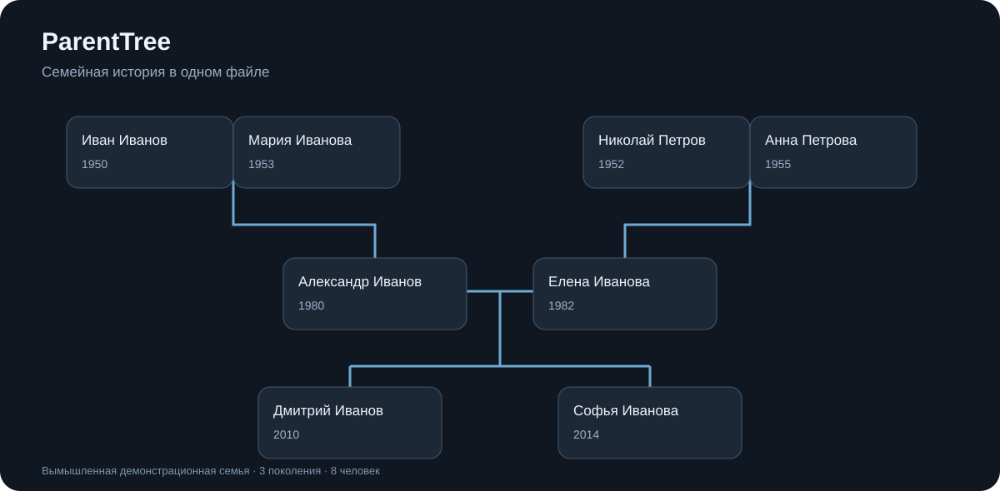

<div align="center">

# ParentTree
### Семейная история — на вашем компьютере

Редактор семейных деревьев для Windows. Люди, родственные связи, фотографии и документы — в одном переносимом файле.

**Windows x64 · .NET 10 LTS · .fam · PNG / PDF**

[Начать работу](docs/USER_GUIDE.md) · [Собрать из исходников](docs/BUILD.md) · [English](README.en.md)

</div>



> На схеме — только вымышленные персонажи из examples/Ивановы.fam. Это иллюстрация структуры, а не снимок интерфейса.

## Что умеет

- Каталог людей и свободная сборка древа на поле.
- Родители, дети, браки; визуальные группы и неопределённые связи.
- Фото, заметки, неполные даты и вложенные документы.
- Переносимый .fam с данными и вложениями внутри.
- Автосохранение, отмена/повтор действий, поиск.
- Экспорт иллюстрации в PNG и PDF.
- Тёмный интерфейс, масштабирование и мини-карта.

Учётная запись не нужна. Документы остаются у вас; приложение не отправляет деревья.
Обычные .fam и экспорт не зашифрованы — делитесь ими осознанно.

## Скачать и запустить

Откройте вкладку **Releases** этого репозитория и скачайте **ParentTree-1.2.0-win-x64.zip**.
Распакуйте в папку с правом записи и запустите **ParentTreeDesktop.exe**.

Рядом лежит обычный демонстрационный .fam: 8 вымышленных людей, 3 поколения, двое детей.
Откройте его через кнопку папки или создайте своё древо кнопкой «Новое».

При отсутствии WebView2 приложение покажет инструкцию.
Отдельный **WebView2-Win10-x64.zip** содержит автономный установщик Microsoft.
[Прямая официальная загрузка WebView2 x64](https://go.microsoft.com/fwlink/?linkid=2124701).

Приложение пока не подписано сертификатом издателя; Windows может показать стандартное предупреждение.
Проверяйте контрольные суммы из SHA256SUMS.txt рядом с релизом.

## Ваши файлы

**Ctrl+O** — открыть · **Ctrl+S** — сохранить · **Ctrl+Shift+S** — сохранить как.

После правок автосохранение ждёт 3 секунды. Безымянному древу сначала задайте файл.
Рядом с EXE создаётся **ParentTreeData**: настройки, автокопия и профиль интерфейса.
Для переноса работы копируйте эту папку, программу и ваши .fam; на новом ПК при необходимости выберите документ заново.
Чтобы отдать другому человеку чистую программу, передавайте релизный архив, без своего ParentTreeData.

## Для разработчиков

```powershell
npm --prefix web ci
npm --prefix web test
./build.ps1
```

Нужны .NET SDK 10 LTS и Node.js 24. Подробности и тесты — в [инструкции сборки](docs/BUILD.md).
Сведения о [формате .fam](docs/FILE_FORMAT.md), [безопасности](SECURITY.md), [участии](CONTRIBUTING.md) и [сторонних компонентах](THIRD_PARTY_NOTICES.md).

Исходники и история этого репозитория подготовлены отдельно; демонстрационные документы вымышлены.
Проверки состава публикации описаны в [отчёте](docs/RELEASE_AUDIT.md).

## Лицензия

Код ParentTree — [GNU GPL v3.0](LICENSE), обозначение **GPL-3.0-only**. При распространении изменённых версий соблюдайте GPL и предоставляйте соответствующие исходники. Сторонние компоненты сохраняют свои лицензии; Microsoft WebView2 Runtime лицензируется отдельно.
